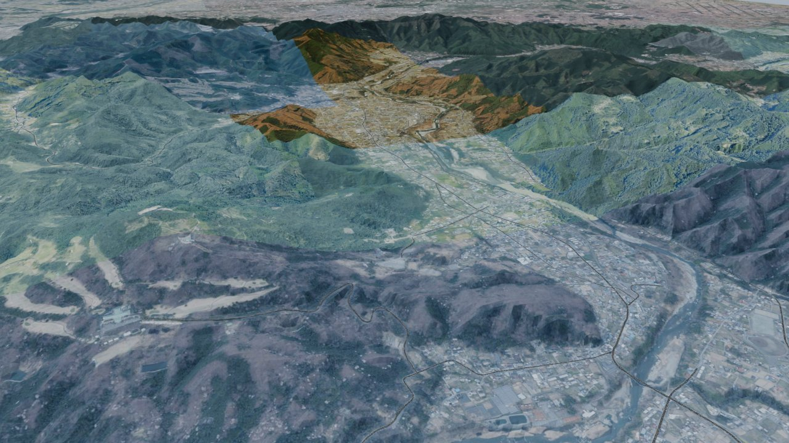
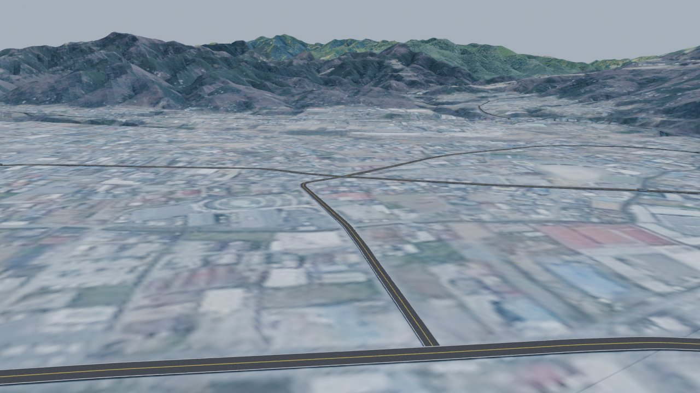
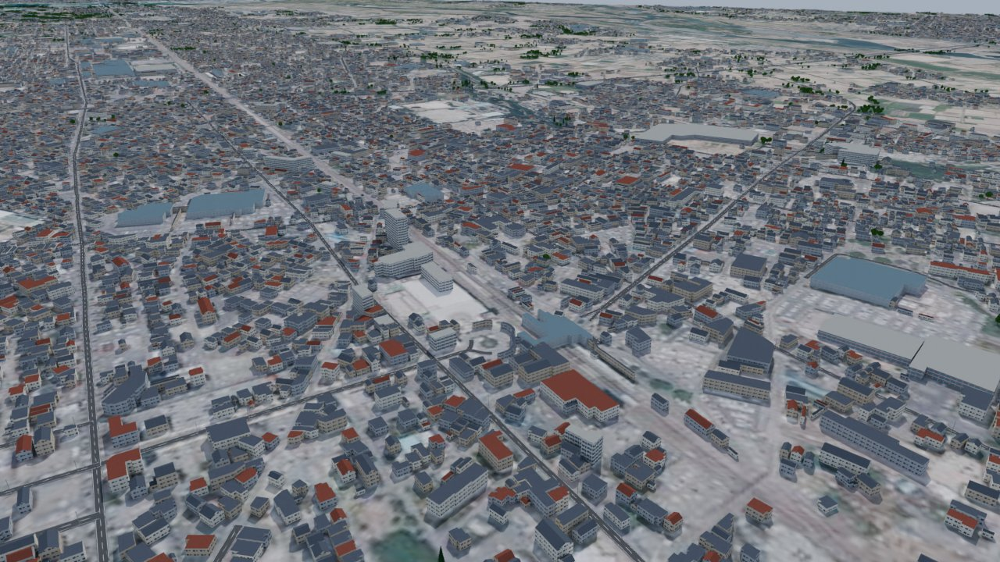
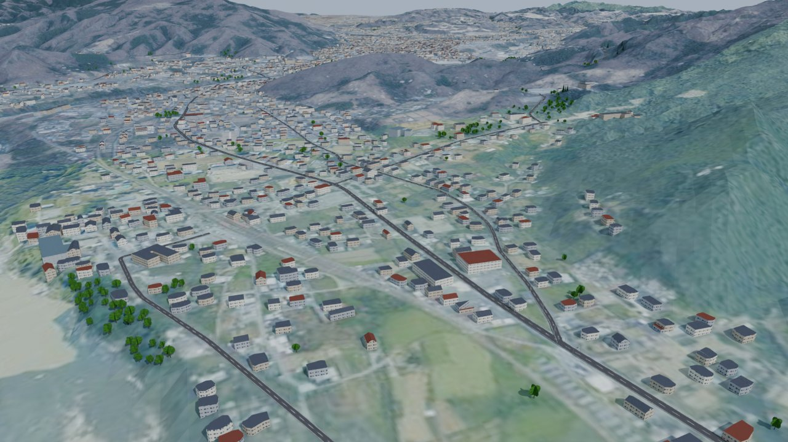
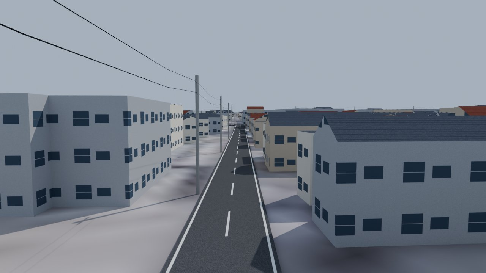

# アセコル 日本再現マップ ツールキット

Assetto Corsa (アセコル) 用に、日本の実在の道路を再現したトラックを作るためのツール群です。

- **道路の形** … OpenStreetMap (OSM)
- **標高・地形** … 国土地理院 標高タイル (5m / 10m メッシュ)
- **出力** … `.kn5` 入りのトラックフォルダを直接作ります。`content/tracks/` にコピーするだけで走れます
  (KsEditor は不要。Blender で手を加えたいとき用に FBX も出せます)

```
config/*.json ──► fetch_*.py ──► data/<id>/ ──► build_track.py / build_region.py ──► out/<id>/<id>/  (kn5 入りトラックフォルダ)
                                                                                 └─► out/<id>/build/ (OBJ・テクスチャ → 任意で Blender / FBX)
```

## 必要なもの

- Python 3.10+ (`pip install -r requirements.txt`)
- 任意: [Blender](https://www.blender.org/) 3.6 以降 (モデルに手を加えたいときだけ)
- 任意: Custom Shaders Patch / Content Manager (動作確認・AI ライン作成が楽)

## 使い方

### 1. 場所を決めて config を作る

`config/hakone_turnpike.json` (箱根ターンパイク) をコピーして編集します。

| 項目 | 説明 |
| --- | --- |
| `track_id` | フォルダ名・kn5 名 (半角英数字と `_`) |
| `bbox` | `[南端緯度, 西端経度, 北端緯度, 東端経度]`。Google マップ等で確認 |
| `route.name_regex` | コースにする道路名 (正規表現)。`name` / `name:ja` / `name:en` / `ref` を検索 |
| `route.highway` | 対象にする道路種別 (`primary`, `secondary` …) |
| `route.way_ids` | OSM の way ID を直接指定する場合 (指定すると上の条件は無視) |
| `road_width` / `shoulder_width` | 車道幅 / 路肩幅 [m] |
| `elevation_smooth_m` | 路面の高さをならす距離。凸凹する場合は大きく |
| `terrain.cell_m` | 地形メッシュの細かさ [m] |
| `reverse` | 走行方向を逆にする |
| `pit_boxes` | ピット数 = 同時出走台数 |

条件に合う道路のうち **一番長くつながる 1 本** が自動でコースになります (上下線が分かれている道路も片側だけ選ばれます)。

### 2. データ取得

```bash
python tools/fetch_osm.py config/hakone_turnpike.json   # 範囲内の道路名一覧も表示される
python tools/fetch_dem.py config/hakone_turnpike.json
```

Overpass API に繋がらない場合は [openstreetmap.org/export](https://www.openstreetmap.org/export) で範囲を `.osm` として保存し、
`python tools/fetch_osm.py config/xxx.json --osm-file map.osm` で読み込めます。

### 3. トラックを作る

```bash
python tools/build_track.py config/hakone_turnpike.json
```

生成されるオブジェクト (名前の頭の数字 + キーワードで AC が物理面を判定します):

| オブジェクト | 内容 |
| --- | --- |
| `1ROAD` | 車道 |
| `2SHOULDER_L` / `3SHOULDER_R` | 路肩 (surfaces.ini の `SHOULDER`) |
| `1WALL_L` / `2WALL_R` | ガードレール (高さ 0.85m のコリジョン壁) |
| `1GRASS_00`… | 地形 (65,535 頂点制限に合わせて分割) |
| `AC_PIT_n` / `AC_START_n` / `AC_HOTLAP_START_0` | スポーン位置 |
| `AC_TIME_0_L/R`, `AC_TIME_1_L/R` | 計測ライン |
| `AC_OPEN_START_L/R`, `AC_OPEN_FINISH_L/R` | 片道 (A→B) コース用スタート / ゴール |

### 4. ゲームに入れる

`out/hakone_turnpike/hakone_turnpike/` フォルダごと
`steamapps/common/assettocorsa/content/tracks/` にコピーします。

```
hakone_turnpike/
├── hakone_turnpike.kn5
├── map.png
├── data/  map.ini, surfaces.ini
└── ui/    ui_track.json, outline.png  (preview.png は自分でスクショを置く)
```

`.kn5` はツールが直接書き出します (形式はコミュニティで解析された version 5。
[moppius/blender-assetto-corsa-tools](https://github.com/moppius/blender-assetto-corsa-tools) の出力と座標・面の向き・
スタート位置の向きが一致することを確認済み)。

**モデルに手を加えたい場合 (任意):** `blender -b -P blender/import_to_blender.py -- out/hakone_turnpike/build` で
`track.blend` と FBX ができるので、Blender で編集して KsEditor か上記の Blender アドオンで kn5 にし直してください。

**AI ライン** は自動生成できないので、ゲーム内で 1 周 (1 本) 走って記録します
(Content Manager / CSP の AI ライン記録機能、またはデベロッパーアプリ)。`ai/fast_lane.ai` が無くても練習走行はできます。

## 広域マップ (フリーローム) モード

1 本のコースではなく、ある地域の道路網をまるごと走れるマップを作ります。
例: `config/honjo_chichibu.json` (埼玉県 本庄市〜秩父郡 皆野・長瀞・小鹿野・東秩父・横瀬、約 24km × 35km)








生成結果の目安 (この例): 道路 1,557 km / 建物 27.4 万棟 / 木 15 万本 / 信号 1,434 / 電柱 2.1 万本 /
ガードレール 82 km、合計約 1,450 万頂点 (kn5 4 つで約 880MB)。生成に約 10 分 (初回はダウンロード込みでさらに 30 分ほど)。

```bash
python tools/fetch_osm.py       config/honjo_chichibu.json   # 道路・建物・信号など (OSM)
python tools/fetch_dem.py       config/honjo_chichibu.json   # 標高
python tools/fetch_buildings.py config/honjo_chichibu.json   # 建物 (地理院ベクトルタイル。OSM に無い建物を補う)
MAPILLARY_TOKEN=MLY|xxxx python tools/fetch_mapillary.py config/honjo_chichibu.json   # 任意
python tools/build_region.py    config/honjo_chichibu.json   # out/honjo_chichibu/honjo_chichibu/ に kn5 入りで完成
```

| 項目 | 説明 |
| --- | --- |
| `highway` | 入れる道路の種別。`unclassified` (市町村道) や `residential` を足すと細い道も入るが重くなる |
| `start` | スポーン位置 (緯度経度)。近くの道路にピットとグリッドが並ぶ |
| `terrain.cell_m` | 地形の細かさ。広域なので 20m 程度 (小さくすると頂点数が急増) |
| `terrain.chunk_cells` | 地形を何マスごとに分けるか。1 チャンクに航空写真 1 枚 |
| `photo.zoom` / `photo.tex_size` | 航空写真の解像度。17 / 2048 にすると綺麗だがダウンロードと容量が 4 倍 |
| `buildings.max_distance_from_road` | 道路からこの距離 [m] 以内の建物だけ置く (遠くまで置くと重い) |
| `trees.spacing_m` / `band_m` / `max_count` | 木の間隔、道路からの距離の範囲 [m]、本数の上限 |
| `details.*` | 歩道・ガードレール・街灯・標識・電柱をそれぞれ ON/OFF |

### 入るもの

| もの | 情報源 | 内容 |
| --- | --- | --- |
| 道路 | OSM | 交差点ごとに区間に分け、交差点の高さを共有 (段差なし)。車線数・一方通行・追越し禁止から白線 / 黄色線を描き分け |
| 橋・トンネル | OSM | 橋は両端を結んで欄干付き。トンネルは**山に穴を開けない** (中に入ると空が見える) |
| 地形 | 地理院 標高 + 航空写真 | 道路の周りは道路の高さに合わせて削る / 盛る |
| 建物 | OSM + 地理院ベクトルタイル | 形はそのまま、高さは階数タグか種類から。小さい長方形の家は切妻の瓦屋根 |
| 木 | 地理院 航空写真 | 道路から見える帯の中で、写真が濃い緑の所に杉 / 広葉樹 |
| 歩道 | OSM `sidewalk=*` | 高さ 15cm の縁石付き (OSM に描かれている所だけ) |
| ガードレール | 地形 + OSM | 路肩の外が 3m 以上落ち込む所 (山道の谷側) と OSM の `barrier=guard_rail` に白いガードレール |
| 信号 | OSM (+ Mapillary) | 日本式の横型 3 灯を両方向に |
| 電柱・電線 | OSM / Mapillary / 自動 | 位置が分かればそこに、無ければ町の中の道路の片側に 35m おき |
| 標識 | OSM `maxspeed`・`highway=stop` (+ Mapillary) | 速度制限と止まれ |
| 街灯 | OSM / Mapillary | 位置が分かる所だけ |

Google ストリートビューは利用規約で地図データの作成に使うことが禁止されているので使いません。
道路写真からの情報が欲しいときは、オープンライセンスの [Mapillary](https://www.mapillary.com/) を使います
(`tools/fetch_mapillary.py`、無料のアクセストークンが必要)。

### 出力

広域モードは重くなるので kn5 を 3 つに分け、`models.ini` でまとめて読み込みます。

| kn5 | 中身 | 物理 | 遠くで消える距離 |
| --- | --- | --- | --- |
| `<id>.kn5` | 地形 (航空写真は DXT1 + ミップマップの DDS)・道路・歩道・ガードレール・スタート位置 | あり | なし |
| `<id>_objects.kn5` | 建物・電柱・電線・信号・標識 | なし (見た目だけ) | 建物 2.5km / 電柱 700m / 電線 400m など |
| `<id>_trees.kn5` | 木 (`ksPerPixelAT` で葉の形に抜く) | なし | 900m |

## うまくいかないとき

- **車が逆向きに出てくる** → config の `reverse` を切り替えるか、`start` の位置を変えて作り直す
- **路面がガタガタ** → `elevation_smooth_m` を 60〜100 に
- **地形が道路を突き抜ける / 崖が不自然** → `terrain.cell_m` を小さく、`terrain.corridor_m` を大きく
- **違う道が選ばれる** → `fetch_osm.py` が表示する道路名を見て `name_regex` を調整、または `way_ids` で直接指定
  (way ID は openstreetmap.org で道路をクリックすると分かります)
- **頂点が多すぎて重い** → `terrain.cell_m` / `terrain.margin_m` を調整

## ライセンス・出典表記

配布する場合は以下の表記が必要です。

- 道路・建物データ: © OpenStreetMap contributors (ODbL)
- 標高・航空写真・建物: 国土地理院 (標高タイル / 全国最新写真 (シームレス) / ベクトルタイル)
- Mapillary を使った場合: © Mapillary (CC BY-SA)
